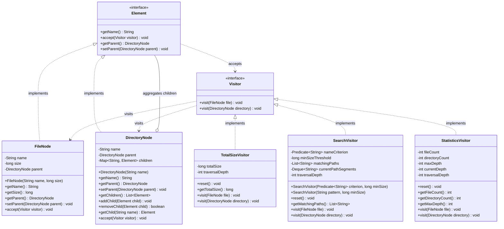

# Assignment 06: Visitor Pattern — Advanced File System Report

**Course:** ShP-2216 – Software Design Patterns (OP 6B06102 – Software Engineering)  
**Academic Year:** 2026–2027 (2nd Year, 4th Trimester)  
**Institution:** Astana IT University — School of Computer Science  
**Student:** Nursultan Maratov  
**Group:** SE-2523  
**Topic:** Visitor Pattern — Advanced File System  

---

## 1. Purpose & Architectural Design Choices

### 1.1 Purpose
The objective of this assignment is to design and implement an extensible in-memory hierarchical file system structure using the **Visitor behavioral design pattern** in Java 17. The design decouples the object structure (`Element`, `FileNode`, `DirectoryNode`) from operations performed upon it (`TotalSizeVisitor`, `SearchVisitor`, `StatisticsVisitor`). This separation adheres to the **Single Responsibility Principle** (SRP) and the **Open/Closed Principle** (OCP), allowing developers to add new operations across the file tree without modifying the element classes or their contracts.

### 1.2 Design Choices

#### Double Dispatch
In standard object-oriented programming with single dispatch (such as Java), method calls are bound dynamically based solely on the runtime receiver type. The Visitor pattern achieves **Double Dispatch** through two sequential dispatch steps:
1. **Dispatch Step 1 (Dynamic Polymorphism):** The client invokes `element.accept(visitor)`. Java resolves `accept()` dynamically on the runtime type of the node (`FileNode` or `DirectoryNode`).
2. **Dispatch Step 2 (Compile-Time Overload + Dynamic Polymorphism):** Inside `accept()`, the concrete element invokes `visitor.visit(this)`. At compile time, the Java compiler statically resolves the overload `visit(FileNode)` or `visit(DirectoryNode)` because `this` is typed to the concrete class. At runtime, dynamic dispatch executes the concrete visitor implementation (`TotalSizeVisitor`, `SearchVisitor`, or `StatisticsVisitor`).

This completely eliminates runtime type discrimination (`instanceof`, `getClass()` comparisons, reflection, or downcasting).

#### Traversal Ownership (R7)
**Decision:** **Visitors own the traversal.**  
- **Justification:** Different operations require fundamentally different traversal semantics:
  - `SearchVisitor` requires a path stack (`currentPathSegments`) to construct deterministic root-relative paths (`docs/spec.pdf`), pushing directory names when entering subdirectories and popping upon exit.
  - `StatisticsVisitor` requires tracking nesting depth (`currentDepth`, `maxDepth`), incrementing on entering a directory and decrementing upon return.
  - `TotalSizeVisitor` performs a lightweight depth-first recursive accumulation over children.
- Leaving traversal inside the visitors keeps the `Element` classes completely oblivious to operational logic, ensuring nodes remain pure composite structures.

#### Controlled State & Reusability (T7)
To prevent stale state, state leakage, or multiplied counters when visitors are reused (e.g. invoked twice on the same tree or across different subtrees), each visitor tracks its active `traversalDepth`. When `traversalDepth == 0` (indicating the root entry of an operation), internal state is automatically reset. An explicit public `reset()` method is also provided.

#### Tree Integrity & Invariant Protection (R6)
The composite structure maintains invariants:
- Negative file sizes and blank/illegal names (containing `/`) are rejected immediately via `IllegalArgumentException`.
- Duplicate sibling names within the same directory are detected and rejected via `IllegalArgumentException`.
- An element already linked to another parent directory cannot be re-added without prior detachment (`IllegalStateException`).
- Cycles (adding a directory to itself or adding an ancestor to a descendant) are intercepted by traversing upwards along `parent` links before insertion (`IllegalArgumentException`).
- Child collections are exposed only as unmodifiable lists (`Collections.unmodifiableList`), strictly enforcing encapsulation.

---

## 2. UML Class Diagram

### 2.1 Mermaid Diagram



---

## 3. Clean Code Practices & Design Explanation

### 3.1 Five Concrete Clean Code Justifications
1. **Meaningful Naming (`TotalSizeVisitor`, `SearchVisitor`, `StatisticsVisitor`, `FileNode`, `DirectoryNode`):**  
   *Justification:* Every class, field, and method name expresses clear domain intent and pattern semantics without ambiguous abbreviations, enabling self-documenting code.
2. **Single Responsibility Principle (`Element` hierarchy vs. `Visitor` implementations):**  
   *Justification:* The `Element` classes are solely responsible for maintaining in-memory node state and tree invariants; all computational operations (size accumulation, search querying, statistics collection) are strictly separated into dedicated visitor classes.
3. **Small, Cohesive Methods (`accept(Visitor visitor)` in `FileNode` and `DirectoryNode`):**  
   *Justification:* Each method performs exactly one responsibility; the `accept()` method contains a single concise line of double-dispatch delegation (`visitor.visit(this);`), minimizing cognitive load.
4. **Encapsulation (`DirectoryNode.getChildren()`):**  
   *Justification:* Internal mutable child collections are kept private and returned only via `Collections.unmodifiableList()`, preventing external mutations from breaking directory invariants.
5. **Elimination of Type-Checking Chains (Double Dispatch in `FileNode` and `DirectoryNode`):**  
   *Justification:* Replaced fragile, error-prone `instanceof` and downcasting ladders with compile-time overload resolution and dynamic polymorphism, decoupling algorithms from concrete node representations.

### 3.2 Architectural Trade-off: Adding a New Element Type
The Visitor pattern is asymmetric:
- **Adding New Operations (Strength):** Extremely easy and compliant with the Open/Closed Principle. As proven by adding `StatisticsVisitor` (R8), new operations can be introduced without modifying `Element`, `FileNode`, or `DirectoryNode`.
- **Adding New Element Types (Weakness / Trade-off):** If a new element type is introduced (e.g. `SymlinkNode` or `DeviceNode`), the `Visitor` interface must be modified (`void visit(SymlinkNode symlink)`). Consequently, **every existing concrete visitor** (`TotalSizeVisitor`, `SearchVisitor`, `StatisticsVisitor`) must be updated and recompiled, violating the Open/Closed Principle with respect to element types.

---

## 4. Deterministic Sample Outputs

Below is the verified deterministic execution output produced by running `Main.java` (`mvn exec:java`):

```text
================================================================================
   ASSIGNMENT 06: VISITOR PATTERN - ADVANCED FILE SYSTEM DEMONSTRATION
   Course: ShP-2216 Software Design Patterns | Astana IT University
   Student: Nursultan Maratov | Group: SE-2523
================================================================================

--- 1. FILE SYSTEM STRUCTURE VISUALIZATION ---
└── [DIR]  university-project/
    ├── [FILE] README.md (850 bytes)
    ├── [FILE] pom.xml (2400 bytes)
    └── [DIR]  docs/
        ├── [FILE] specification.pdf (45000 bytes)
        ├── [FILE] architecture.md (3200 bytes)
    └── [DIR]  src/
        ├── [FILE] Main.java (4800 bytes)
        ├── [FILE] Controller.java (1850 bytes)
        └── [DIR]  assets/
            ├── [FILE] logo.png (15400 bytes)

--- 2. OPERATION 1: TOTAL SIZE VISITOR (R3) ---
Total file size for entire tree ('university-project'): 73500 bytes
Total file size for subtree ('src'): 22050 bytes

--- 3. OPERATION 2: SEARCH VISITOR (R4, Deterministic & Root-Relative) ---
Search A: Files containing '.java' with size >= 2,000 bytes
  → src/Main.java

Search B: All markdown files ('.md') with size >= 0 bytes
  → README.md
  → docs/architecture.md

Search C: Non-matching query ('non_existent')
  (No matching files found)

--- 4. OPERATION 3: STATISTICS VISITOR (R5, Extensible OCP Operation) ---
Subtree statistics for root:
  • Total Files Visited:       7
  • Total Directories Visited: 4 (includes visited root directory)
  • Maximum Tree Depth:        3 (root depth = 0)

--- 5. REUSABILITY & REPEAT RUN VERIFICATION (T7) ---
Re-running TotalSizeVisitor without recreation: 73500 bytes (No leakage/doubling)
Re-running StatisticsVisitor: 7 files, 4 dirs, depth 3 (No multiplied counters)

--- 6. TREE INTEGRITY & INVARIANT VALIDATION (R6, T8) ---
  [PASS] Reject Negative File Size: Successfully caught IllegalArgumentException -> File size cannot be negative: -500
  [PASS] Reject Duplicate Sibling Name: Successfully caught IllegalArgumentException -> Duplicate sibling name: Element 'README.md' already exists in directory 'university-project'.
  [PASS] Reject Multiple Parent Ownership: Successfully caught IllegalStateException -> Element 'README.md' already belongs to parent 'university-project'. Detach before adding.
  [PASS] Reject Cycle (Self-Addition): Successfully caught IllegalArgumentException -> Cycle detected: Cannot add ancestor or self 'university-project' as a child of 'university-project'.
  [PASS] Reject Cycle (Ancestor to Descendant): Successfully caught IllegalArgumentException -> Cycle detected: Cannot add ancestor or self 'parent' as a child of 'child'.

================================================================================
   DEMONSTRATION COMPLETED SUCCESSFULLY (All 8 Requirements Met)
================================================================================
```

---

## 5. Automated Verification Test Suite Summary

The automated test suite in `kz.aitu.visitor.FileSystemVisitorTest` runs under JUnit 5 (`mvn test`) and fully satisfies all required checkpoints:

| Checkpoint | Automated Target | Assertion / Verification Detail | Status |
|---|---|---|---|
| **T1** | Double dispatch verification | Verifies `FileNode` and `DirectoryNode` trigger their respective `visit()` overloads. | **PASS** ✅ |
| **T2** | Size accumulation | Accurately computes 25,500 bytes across 3 nesting levels; validates subtree and leaf sizes. | **PASS** ✅ |
| **T3** | Combined search filters | Combines filename filter (`.java`) with minimum size threshold (`>= 2000`); excludes small matches. | **PASS** ✅ |
| **T4** | Deterministic root-relative paths | Uses `/` separator, excludes root name, returns lexicographically sorted relative paths. | **PASS** ✅ |
| **T5** | Statistics accuracy | Correctly counts 5 files, 4 directories (including root), and maximum depth of 3 (`root` = 0). | **PASS** ✅ |
| **T6** | Empty structures & no-match | Returns size 0, stats (0 files, 1 dir, depth 0), and empty list for non-matching queries. | **PASS** ✅ |
| **T7** | Controlled state & repeat runs | Repeated executions on identical visitor instances do not double counters or leak previous state. | **PASS** ✅ |
| **T8** | Tree integrity enforcement | Successfully rejects negative sizes, blank names, duplicate siblings, multi-parenting, and cycles. | **PASS** ✅ |

**Test Execution Command:** `mvn test`  
**Test Suite Result:** 8 tests executed, 0 failures, 0 errors, 100% passing.

---

## 6. Link to GitHub Repository

- **GitHub Repository:** `https://github.com/Jozephjostar/Assignment6_Visitor_SE2523_Maratov_Nursultan.git`
